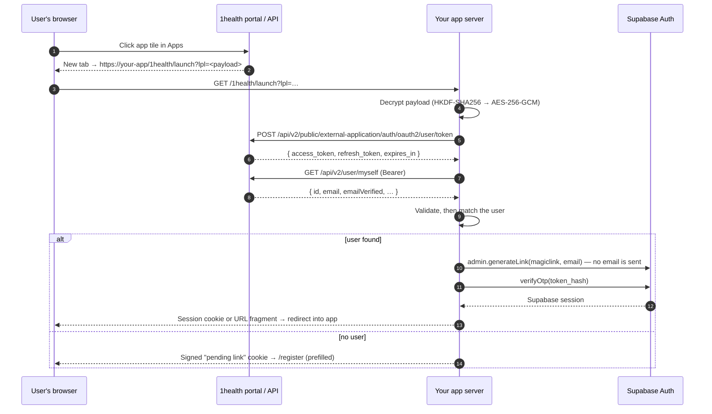

# Single Sign-On from the 1health App Launcher into a Supabase-Authenticated App

**Technical white paper for developers.** Version 0.3 (draft), October 2026. Tachin.

> **Changes in v0.3:** robustness fixes from the first live integration (a Better Auth app; see the companion Better Auth paper and `02a-carrier-case-study.md`).
> - Non-JWT tokens, non-JSON `/myself` responses and network errors now map to stable error codes.
> - `/myself` emails must be real addresses. Demo QA users return usernames.
> - The launch route turns *any* unexpected error into `?error=launch_failed`.
> - New pre-merge testing techniques are in §7.
>
> **Verification.** The Next.js templates ran live against 1health demo in `reference/supabase-next` (Next 16, `@supabase/ssr`, local Supabase), with a real demo user. All six scenarios passed: auto-link, relaunch, prefilled registration, sign-up gate rejection, identity conflict, and confirm-first-link. Minting the session sent no email. The FastAPI template has a 14-test pytest suite but hasn't run live. Hosted-project settings (Site URL, redirect allow-list) are untested.
>
> **Finding:** Supabase reports a sign-up gate's rejection (a trigger on `auth.users` or a before-user-created hook) as a 500 "Database error creating new user". The trigger's message is lost, so map that case to the gate's copy (§5.8).

---

## 1. Summary

Users of 1health can open third-party apps from the 1health **Apps** screen. This paper explains how to make that launch sign the user **straight into your existing app**, when the app already uses **Supabase Auth** for its own users.

The target behaviour:

- If the user's 1health email matches an account in your app, clicking the app in 1health opens it in a new tab with the user **already signed in**. There is no second password prompt.
- If no account matches, the app opens on **registration**. The email (and name, if 1health supplies it) is already filled in. When the user finishes registering, the 1health identity is **linked** and the user is signed in. They do not need to launch again.
- Normal sign-in, for people who never use 1health, is unchanged.

The solution has three parts:

1. **Verify the launch.** Decrypt the 1health *launch payload* and redeem its one-time code for a 1health access token.
2. **Resolve the identity.** Fetch the user's 1health profile (email, verification status, IDs) and match it to a Supabase user.
3. **Issue a native Supabase session** with the Supabase Admin API (`generateLink`, then `verifyOtp`). The user gets an ordinary Supabase session that works with row-level security (RLS) and refreshes normally.

Nothing on the 1health platform needs to change. You do not make 1health a Supabase identity provider, and you do not configure OAuth redirect URIs, client IDs or scopes. The 1health side consists of registering the app and handling one shared secret.

The design described here has been run end to end against a production Supabase app on 1health's demo environment. §9 lists where 1health's published documentation and that working implementation disagree.

> **Verification status.** The protocol handshake (decrypt → redeem → `/myself`) and the Supabase session step (`generateLink` + verify) are proven against 1health demo by a production implementation. That implementation called `/auth/v1/verify` directly, not `verifyOtp`. The TypeScript snippets type-check against `@supabase/supabase-js` 2.118 and `@supabase/ssr` 0.12. `verify_otp({token_hash, type: "magiclink"})` exists in supabase-py's auth client. The full code in this paper has not yet been run end to end as written.

---

## 2. The 1health launch protocol

1health uses its own launch handshake. It is **not** OAuth 2.0 authorization-code or OIDC. It is closer in spirit to a SMART-on-FHIR "EHR launch": the portal starts the launch, and your server proves it holds a shared secret.

### 2.1 Secrets and identifiers

| Item | Where it comes from | Purpose |
|---|---|---|
| **External Application** | 1health → tenant **Settings → Apps** (or `POST /api/v2/external-application`) | The tile users click. Holds your **launch URL** (also called the "vendor URL"). |
| **Launch secret** | Created with the app, or generated in the 1health UI as an API key and assigned to the app. **Shown only once.** | Decrypts the launch payload and signs the one-time-code redemption. Server-side only. |
| **External Application ID** | The app record | Lets you check that a token was issued for *your* app. |
| **API base URL** | Fixed per environment | Demo: `https://demo.1health.io`. Production: `https://app.1health.io`. |

Demo and production are separate. Each has its own app registration, launch secret and app ID.

### 2.2 Sequence



### 2.3 The launch payload (`lpl`)

1health opens `https://<launch-url>?lpl=<payload>`, where

```
payload = Base64( IV[12 bytes] || AES-256-GCM ciphertext || tag[16 bytes] )
key     = HKDF-SHA256( IKM = launch secret (UTF-8), salt = none, info = none, length = 32 )
```

There is no additional authenticated data (AAD). Under RFC 5869, "no salt" means 32 zero bytes, so implementations that pass an empty salt or explicit zeros give the same key.

The decrypted JSON:

```json
{
  "required": {
    "apiKey":      { "name": "…" },
    "tenant":      { "id": 123 },
    "user":        { "id": 456 },
    "oneTimeCode": { "value": "Ab12Cd34Ef56Gh78", "issuedAt": "…", "expiresAt": "…" }
  },
  "optional": {
    "user_first_name": "…", "user_last_name": "…",
    "provider_npi": "…", "journey_id": "…", "encounter_id": "…"
  }
}
```

- The **one-time code is single-use and short-lived.** 1health's API reference says it is *"typically 5–10 minutes"*. Reusing it, for example by reloading the launched tab, is rejected. Redeem it immediately, and when it fails send the user back to 1health to launch again.
- The `optional` block is context. Use the name fields to prefill registration. Treat the clinical context fields as hints, never as authorization.

### 2.4 Redeeming the one-time code

```
POST {BASE}/api/v2/public/external-application/auth/oauth2/user/token
Content-Type: application/json

{ "securityCode": "<oneTimeCode>",
  "signature":    "<Base64( HMAC-SHA256( key = launch secret, message = oneTimeCode ) )>" }
```

This endpoint is public. The signature authenticates you. Note that the HMAC key is the **raw launch secret**, not the HKDF-derived key. The response is a standard OAuth2 token response (`access_token`, `refresh_token`, `expires_in`, `scope`). The External Application must be **ACTIVE**.

### 2.5 The user's identity

The access token is a JWT, but its identifying claims (`sub`, `userId`, `username`, `roles`, …) are **encrypted**. Only `tenantId`, `externalApplicationId`, `iat` and `exp` are plain text. Get the identity from:

```
GET {BASE}/api/v2/user/myself
Authorization: Bearer <access_token>
```

This returns `id`, `email`, `username`, **`emailVerified`**, `tenants`, `tenantContext` and much more, possibly including date of birth and partial SSN. Read only what you need. Never log, store or forward the rest.

---

## 3. Configuration

### 3.1 1health

1. Sign in to 1health (start in demo) as a tenant **manager** and switch to the tenant that will own the app.
2. **Settings → Apps → add an External Application.** Set its name, icon, and launch URL, e.g. `https://app.example.com/1health/launch`. The URL must be **HTTPS** and must exactly match a host your server accepts.
3. Get the **launch secret** (generate an API key and assign it to the app, or copy `launchSecret` from the create response). Put it straight into your secrets manager. If the tenant has several keys, make sure the **assigned** key is the one you configure.
4. Note the **External Application ID**. Move the app to **Active** and set visibility (`isPublic`, or allowed organizations for private apps).
5. Make sure the users who will test have a role that sees the Apps screen. In practice that is *manager*; the *employee* role did not show it.
6. Repeat on production (`app.1health.io`) when you go live. It has a separate secret and a separate ID.

### 3.2 Supabase

| Setting | Value | Why |
|---|---|---|
| Auth → Providers → **Email** | Enabled | `generateLink({type:'magiclink'})` needs it. |
| Auth → URL Configuration → **Site URL** | Your production origin | Supabase builds verification redirects from it. The default `http://localhost:3000` breaks raw `/verify` flows. |
| **Redirect URLs** | Production, staging, and local HTTPS origins | For any flow that redirects through `/auth/v1/verify`. |
| **JWT signing keys** | Asymmetric (ES256/RS256) recommended | The sessions you create are genuine Supabase JWTs, so RLS and `auth.uid()` work unchanged. |
| **Service role key** | Server only | Required for `auth.admin.*`. |

Migration (adjust the table names to your schema):

```sql
alter table public.profiles
  add column if not exists one_health_env       text,   -- 'demo' | 'prod'
  add column if not exists one_health_tenant_id text,
  add column if not exists one_health_user_id   text;

create unique index if not exists profiles_one_health_identity_uidx
  on public.profiles (one_health_env, one_health_tenant_id, one_health_user_id)
  where one_health_user_id is not null;

-- Plus a trigger that stops anon/authenticated from writing one_health_* (§5.5); see the skill's sql/supabase.sql.

create table if not exists public.one_health_launch_audit (
  id bigint generated always as identity primary key,
  created_at timestamptz not null default now(),
  outcome text not null check (outcome in ('success','no_user','failure')),
  failure_reason text,
  one_health_env text, one_health_tenant_id text, one_health_user_id text,
  app_user_id uuid
);
alter table public.one_health_launch_audit enable row level security;   -- no policies: service role only
grant insert, select on public.one_health_launch_audit to service_role;
```

Tables created with raw SQL may not get the grants you expect. A missing `GRANT … TO service_role` shows up as `permission denied for table …`.

Email lookup helper. Use it if you don't keep emails in a profile table:

```sql
create or replace function public.auth_user_id_by_email(p_email text)
returns uuid language sql security definer set search_path = '' as $$
  select id from auth.users where lower(email) = lower(p_email) limit 1
$$;
revoke all on function public.auth_user_id_by_email(text) from public, anon, authenticated;
grant execute on function public.auth_user_id_by_email(text) to service_role;
```

### 3.3 Environment variables

| Variable | Notes |
|---|---|
| `ONE_HEALTH_DEMO_LAUNCH_SECRET`, `ONE_HEALTH_DEMO_APP_ID` | Demo registration. |
| `ONE_HEALTH_PROD_LAUNCH_SECRET`, `ONE_HEALTH_PROD_APP_ID` | Production registration. Set only the environments you use. |
| `ONE_HEALTH_ALLOWED_TENANT_IDS` | Optional allow-list, e.g. `demo:123,prod:456`. |
| `ONE_HEALTH_LINK_COOKIE_SECRET` | 32+ random characters (`openssl rand -hex 32`). Signs the pending-link cookie. The app refuses to start without it: `itsdangerous` accepts an empty key, which would make the cookie forgeable. |
| `ONE_HEALTH_LINK_POLICY` | `auto-link` (default; also when empty) or `confirm-first-link`. Any other value is a startup error, never a silent `auto-link`. See §5.4. |
| `SUPABASE_URL`, `SUPABASE_ANON_KEY` (publishable), `SUPABASE_SERVICE_ROLE_KEY` (secret) | Existing. |

The base URLs are constants (`https://demo.1health.io` and `https://app.1health.io`), so they don't need configuration.

**Which environment sent the launch?** Try to decrypt the payload with each configured secret. AES-GCM authenticates, so only the right key succeeds, and that tells you the environment, and so the base URL and app ID, with certainty. Do this instead of trusting `document.referrer`.

### 3.4 Hosting

- **HTTPS is required** for the launch URL.
- The launch is a top-level browser navigation. **No CORS changes are needed.**
- If your framework validates the `Host` header (`TrustedHostMiddleware`, `ALLOWED_HOSTS`), include the launch host. Otherwise the browser gets "Invalid host header" even though `curl` works.
- Make sure query strings (`lpl`) are not written to access logs. Strip them in your proxy's log format.

---

## 4. Components to add

| # | Component | Runs on |
|---|---|---|
| 1 | `decryptLaunchPayload()` (with environment detection) | Server |
| 2 | `redeemOneTimeCode(env, code)` | Server |
| 3 | `resolveLaunch(lpl)`: runs 1 and 2, then `/myself` + validation | Server |
| 4 | `findAppUser()`: by linked 1health ID, then by email | Server (service role) |
| 5 | `linkOneHealthIdentity()` | Server (service role) |
| 6 | `mintSupabaseSession()` | Server |
| 7 | `GET /1health/launch`: runs 3–6, then redirects | Server |
| 8 | Prefilled registration + `POST /1health/complete-registration` | Server + UI |
| 9 | Audit log, rate limit | Server |

The 1health access and refresh tokens **stay on the server**. Discard them after step 3. If you call 1health APIs on the user's behalf, encrypt them at rest instead. (The 1health app template does the opposite and stores 1health tokens in browser cookies. That template is for apps whose *only* backend is 1health. See §9.)

The code below is shown in **Python (FastAPI + supabase-py)** and **TypeScript (Next.js App Router + `@supabase/ssr`)**.

**Excerpts vs. templates.** The tested, complete code is the skill's templates: `templates/ts/protocol.ts` and `templates/supabase-next/*` (Next.js), and `templates/supabase-fastapi/one_health.py` (FastAPI, where steps 1–3 are one `resolve_launch(lpl)`). In §5, the TypeScript excerpts use the templates' names and signatures, and the blocks marked *template copy* are byte-for-byte copies that CI checks. The **Python excerpts are illustrative**: they split the steps into smaller functions to explain them, and leave out the template's rate limiting, timeouts on every call and `asyncio.to_thread` wrapping. Copy from the template, not from this paper.

---

## 5. Implementation

### 5.1 Decrypt and detect the environment

**Python**

```python
import base64, json, re, os
from cryptography.exceptions import InvalidTag
from cryptography.hazmat.primitives import hashes
from cryptography.hazmat.primitives.ciphers.aead import AESGCM
from cryptography.hazmat.primitives.kdf.hkdf import HKDF

ENVIRONMENTS = {
    "demo": {"base": "https://demo.1health.io", "secret": os.getenv("ONE_HEALTH_DEMO_LAUNCH_SECRET"), "app_id": os.getenv("ONE_HEALTH_DEMO_APP_ID")},
    "prod": {"base": "https://app.1health.io",  "secret": os.getenv("ONE_HEALTH_PROD_LAUNCH_SECRET"), "app_id": os.getenv("ONE_HEALTH_PROD_APP_ID")},
}
_OTC = re.compile(r"^[A-Za-z0-9]{16}$")

class LaunchError(Exception):
    def __init__(self, code: str):
        super().__init__(code)
        self.code = code

def _key(secret: str) -> bytes:
    return HKDF(algorithm=hashes.SHA256(), length=32, salt=None, info=None).derive(secret.encode())

def decrypt_launch_payload(lpl: str) -> dict:
    try:
        raw = base64.b64decode(lpl, validate=True)
    except ValueError:
        raise LaunchError("payload_invalid")
    if len(raw) < 28:
        raise LaunchError("payload_invalid")
    for env, cfg in ENVIRONMENTS.items():
        if not cfg["secret"]:
            continue
        try:
            data = json.loads(AESGCM(_key(cfg["secret"])).decrypt(raw[:12], raw[12:], None))
        except InvalidTag:
            continue                      # wrong environment's key, try the next one
        try:
            req = data["required"]
            code = req["oneTimeCode"]["value"]
            out = {"env": env, "tenant_id": str(req["tenant"]["id"]), "user_id": str(req["user"]["id"]),
                   "code": code, "optional": data.get("optional") or {}}
        except (KeyError, TypeError):
            raise LaunchError("payload_invalid")
        if not isinstance(code, str) or not _OTC.fullmatch(code):
            raise LaunchError("payload_invalid")
        return out
    raise LaunchError("payload_invalid")   # no configured key matched
```

**TypeScript**

```ts
import { createDecipheriv, hkdfSync } from "node:crypto";

export const ENVIRONMENTS = {
  demo: { base: "https://demo.1health.io", secret: process.env.ONE_HEALTH_DEMO_LAUNCH_SECRET, appId: process.env.ONE_HEALTH_DEMO_APP_ID },
  prod: { base: "https://app.1health.io",  secret: process.env.ONE_HEALTH_PROD_LAUNCH_SECRET, appId: process.env.ONE_HEALTH_PROD_APP_ID },
} as const;
export type OneHealthEnv = keyof typeof ENVIRONMENTS;

export export class LaunchError extends Error {
  constructor(public code: string) { super(code); }
}

const deriveKey = (secret: string) =>
  Buffer.from(hkdfSync("sha256", Buffer.from(secret, "utf8"), Buffer.alloc(0), Buffer.alloc(0), 32));

export function decryptLaunchPayload(lpl: string) {
  const raw = Buffer.from(lpl, "base64");
  if (raw.length < 28) throw new LaunchError("payload_invalid");
  const iv = raw.subarray(0, 12), tag = raw.subarray(raw.length - 16), ct = raw.subarray(12, raw.length - 16);
  for (const env of Object.keys(ENVIRONMENTS) as OneHealthEnv[]) {
    const secret = ENVIRONMENTS[env].secret;
    if (!secret) continue;
    let data: any;
    try {
      const d = createDecipheriv("aes-256-gcm", deriveKey(secret), iv);
      d.setAuthTag(tag);
      data = JSON.parse(Buffer.concat([d.update(ct), d.final()]).toString("utf8"));
    } catch { continue; }
    const r = data?.required, code = r?.oneTimeCode?.value;
    if (typeof code !== "string" || !/^[A-Za-z0-9]{16}$/.test(code) || r?.tenant?.id == null || r?.user?.id == null)
      throw new LaunchError("payload_invalid");
    return { env, tenantId: String(r.tenant.id), userId: String(r.user.id), code,
             optional: (data.optional ?? {}) as Record<string, string | undefined> };
  }
  throw new LaunchError("payload_invalid");
}
```

> **Byte-compatibility.** 1health's guidance is not to hand-roll the key derivation. The standard-library HKDF calls above match the platform's derivation: an empty salt is equivalent to 32 zero bytes under RFC 5869. Still, add a unit test that decrypts a payload captured from demo before you rely on any port.

### 5.2 Redeem the one-time code

```python
import hashlib, hmac, httpx

async def redeem_one_time_code(launch: dict) -> dict:
    cfg = ENVIRONMENTS[launch["env"]]
    sig = base64.b64encode(hmac.new(cfg["secret"].encode(), launch["code"].encode(), hashlib.sha256).digest()).decode()
    async with httpx.AsyncClient(timeout=15) as c:
        r = await c.post(f'{cfg["base"]}/api/v2/public/external-application/auth/oauth2/user/token',
                         json={"securityCode": launch["code"], "signature": sig})
    body = r.json() if r.headers.get("content-type", "").startswith("application/json") else {}
    if r.status_code != 200 or not body.get("access_token"):
        raise LaunchError("token_exchange_failed")   # used/expired code, wrong secret, or app not ACTIVE
    return body
```

```ts
// From templates/ts/protocol.ts (its `call` helper inlined): a timeout on every 1health call.
export async function redeemOneTimeCode(env: OneHealthEnv, code: string) {
  const { base, secret } = ENVIRONMENTS[env];
  // HMAC uses the RAW launch secret, not the HKDF-derived key.
  const signature = createHmac("sha256", secret!).update(code, "utf8").digest("base64");
  const res = await fetch(`${base}/api/v2/public/external-application/auth/oauth2/user/token`, {
    method: "POST", headers: { "Content-Type": "application/json" }, cache: "no-store",
    body: JSON.stringify({ securityCode: code, signature }), signal: AbortSignal.timeout(10_000),
  }).catch(() => { throw new LaunchError("token_exchange_failed"); });
  const body = await res.json().catch(() => null);
  if (!res.ok || typeof body?.access_token !== "string") throw new LaunchError("token_exchange_failed");
  return body as { access_token: string; refresh_token?: string; expires_in: number };
}
```

### 5.3 Fetch and validate the identity

```python
import jwt  # PyJWT, used only to read plain-text claims

async def fetch_one_health_identity(tokens: dict, launch: dict) -> dict:
    cfg = ENVIRONMENTS[launch["env"]]
    try:
        claims = jwt.decode(tokens["access_token"], options={"verify_signature": False})
    except jwt.PyJWTError:
        raise LaunchError("token_exchange_failed")
    if str(claims.get("externalApplicationId")) != str(cfg["app_id"]):
        raise LaunchError("wrong_application")
    try:
        async with httpx.AsyncClient(timeout=10) as c:
            r = await c.get(f'{cfg["base"]}/api/v2/user/myself',
                            headers={"Authorization": f'Bearer {tokens["access_token"]}'})
        me = r.json() if r.status_code == 200 else None
    except (httpx.HTTPError, ValueError):
        me = None
    if not isinstance(me, dict):
        raise LaunchError("identity_lookup_failed")
    email = str(me.get("email") or "").strip().lower()
    if not re.fullmatch(r"[^@\s]+@[^@\s]+\.[^@\s]+", email):   # QA/system users return a username here
        raise LaunchError("identity_no_email")
    if me.get("emailVerified") is not True:
        raise LaunchError("email_not_verified")
    if not tenant_allowed(launch["env"], launch["tenant_id"]):
        raise LaunchError("tenant_not_allowed")
    opt = launch["optional"]
    return {"env": launch["env"], "tenant_id": launch["tenant_id"], "user_id": launch["user_id"], "email": email,
            "first_name": opt.get("user_first_name") or me.get("firstName"),
            "last_name":  opt.get("user_last_name")  or me.get("lastName")}
```

The TypeScript version is `resolveLaunch(lpl)` in `templates/ts/protocol.ts` (white paper 02 §5 prints it in full). It decrypts, redeems, and validates in one call, returning `{ env, tenantId, userId, email, firstName, lastName }`. It reads the plain-text claims with `decodeJwt` from `jose`, wrapped in `try`, and puts a timeout on every 1health call (`AbortSignal.timeout(10_000)`).

**Why each check exists**

- **`emailVerified`.** The trust model is the same as "Sign in with Google": 1health vouches that this person controls this email. Matching on an unverified email lets someone take over an account.
- **`externalApplicationId`.** Rejects tokens issued for a different 1health app. 1health's API reference recommends this check. Reading the claim without verifying the signature is acceptable here only because the `/myself` call that follows proves the token is genuine. If 1health publishes a JWKS (§10), verify the signature as well.
- **Lower-case the email, and require an address.** Supabase stores emails in lower case. On demo, QA/system users return a username (e.g. `system_1health_<app>-qa-manager`) in `email`, still with `emailVerified: true`. Treat that as `identity_no_email`. Never match or register on it.
- **Tenant allow-list.** Optional. Use it for private apps or pilots limited to specific organizations.

### 5.4 Find the app user, and choose a linking policy

1. **By linked identity**: `(one_health_env, one_health_tenant_id, one_health_user_id)`. This stays stable even if the user's email changes.
2. **By email**: through your profile table or `auth_user_id_by_email()`.
3. If the email match is **already linked to a different 1health user**, fail with `identity_conflict`. Don't log it and continue.
4. If the matched `auth.users` row is **unconfirmed** (`email_confirmed_at` is null), never link it or mint a session for it, whatever the policy. Anyone can sign up with someone else's address and choose the password; linking that row (the magic-link session would also confirm it) would hand the real owner an account the other person can sign in to. Treat it as `confirm-first-link` below: the link follows the owner's own confirmation and sign-in.
5. Never call `generateLink` to find out whether a user exists. Look the user up first.

When step 2 finds an account that is **not yet linked**, what happens next depends on a policy you choose up front:

| Policy | First launch for an existing, unlinked account | Later launches | Choose it when |
|---|---|---|---|
| **`auto-link`** (default) | Link and sign in straight away on a *verified* email match, if the app account's own email is confirmed (otherwise as `confirm-first-link`) | Silent sign-in on the linked ID | Consumer apps, or wherever "Sign in with Google"-style trust in the email is acceptable |
| **`confirm-first-link`** | Set the pending-link cookie and send the user to your normal sign-in page with a notice ("Sign in once to connect your 1health account"). After a successful sign-in (password, MFA, whatever you normally require), link and continue. | Silent sign-in on the linked ID | Regulated or professional apps, or where an email match alone must not merge accounts |

`confirm-first-link` reuses the pending-link cookie from §5.8. After any normal sign-in, if a valid cookie is present and its email matches the signed-in user, link the identity and clear the cookie. It also closes most of the login-CSRF gap described in §6, because the first link needs the victim's own credentials.

### 5.5 Link the identity

On the first match, write the three `one_health_*` columns with the service role. On later launches, check they still match.

- **Check the write happened.** `update().eq(id)` "succeeds" with zero rows when the user has no profile row (or on a `one_health_links` table). Check the returned rows, insert when nothing matched, and fail with `link_failed` on any error.
- **Only the server may write these columns.** A launch signs in as whichever user's row holds the identity, so a user who could set `one_health_*` on their own row (a typical "users update own profile" RLS policy allows it) could make another person's launch land in their account. A column-level `REVOKE` doesn't help while `authenticated` has the table-level `UPDATE` grant Supabase gives it by default; use a trigger that rejects changes from `anon`/`authenticated`, or keep the link in a `one_health_links` table with RLS on, no policies and only `service_role` grants.

### 5.6 Issue a native Supabase session

Supabase has no Admin API call that says "create a session for user X". The supported route is to **generate** a magic-link token with the Admin API (called this way, **no email is sent**) and then **redeem** it on the server straight away.

**Python**

```python
from supabase import create_client

def mint_supabase_session(email: str) -> dict:
    admin = create_client(SUPABASE_URL, SUPABASE_SERVICE_ROLE_KEY)
    link = admin.auth.admin.generate_link({"type": "magiclink", "email": email})
    anon = create_client(SUPABASE_URL, SUPABASE_ANON_KEY)          # new client per call: clients keep session state
    s = anon.auth.verify_otp({"token_hash": link.properties.hashed_token, "type": "magiclink"}).session
    return {"access_token": s.access_token, "refresh_token": s.refresh_token,
            "expires_in": s.expires_in, "token_type": "bearer"}
```

**TypeScript (`@supabase/ssr`).** `verifyOtp` on the cookie-bound server client **sets the session cookies for you** (template copy, `lib/one-health/session.ts`):

<!-- template: supabase-next/session.ts -->
```ts
// lib/one-health/session.ts — create a native Supabase session for an existing user (server only).
// generateLink(magiclink) through the Admin API sends NO email; verifyOtp on the cookie-bound
// server client redeems it and writes the normal @supabase/ssr session cookies.
import "server-only";
import { createClient } from "@supabase/supabase-js";
import { createServerClient } from "@supabase/ssr";
import { cookies } from "next/headers";
import { LaunchError } from "./protocol";

export function adminClient() {
  return createClient(process.env.SUPABASE_URL ?? process.env.NEXT_PUBLIC_SUPABASE_URL!, process.env.SUPABASE_SERVICE_ROLE_KEY!, {
    auth: { persistSession: false, autoRefreshToken: false },
  });
}

/** Reuse the repo's existing server-client helper if it has one (e.g. lib/supabase/server.ts). */
async function cookieClient() {
  const store = await cookies();
  return createServerClient(process.env.NEXT_PUBLIC_SUPABASE_URL!, process.env.NEXT_PUBLIC_SUPABASE_ANON_KEY!, {
    cookies: {
      getAll: () => store.getAll(),
      setAll: (list) => list.forEach(({ name, value, options }) => store.set(name, value, options)),
    },
  });
}

export async function mintSupabaseSession(email: string): Promise<void> {
  const { data, error } = await adminClient().auth.admin.generateLink({ type: "magiclink", email });
  if (error || !data.properties?.hashed_token) throw new LaunchError("session_mint_failed");
  const supabase = await cookieClient();
  const { error: vErr } = await supabase.auth.verifyOtp({ token_hash: data.properties.hashed_token, type: "magiclink" });
  if (vErr) throw new LaunchError("session_mint_failed");
}
```

Notes:

- Newer SDKs also accept `type: "email"` with a token hash.
- **Don't hand-make JWTs.** A token signed with your own secret is rejected by Supabase/PostgREST (`signature is invalid` or `no suitable key`). The usual workaround, the service-role client with manual `user_id` filters, silently **bypasses RLS**.
- **No fallback.** If minting fails, fail closed and show an error.
- **Keep the refresh token.** If you return only the access token, the session dies after the access-token lifetime, which is one hour by default.

### 5.7 Deliver the session

| Where your app keeps the Supabase session | What to do |
|---|---|
| **Cookies** (`@supabase/ssr`, any SSR framework) | §5.6 has already set them. Return `303 → /`. |
| **supabase-js in the browser** (SPA) | `303 → /#access_token=…&refresh_token=…&expires_in=…&token_type=bearer&type=magiclink`. With the default `flowType: 'implicit'`, `detectSessionInUrl` stores it. With `pkce`, read the fragment and call `supabase.auth.setSession({ access_token, refresh_token })`. |
| **Custom storage** (e.g. a bearer token in `localStorage`) | Same fragment redirect. Your boot script stores both tokens and calls `history.replaceState` to remove the fragment. |

Browsers never send URL fragments to servers or include them in `Referer` headers. Do the whole launch in **one server request that ends in a redirect**. Don't return JSON to a top-level navigation.

**FastAPI route** (illustrative; the template's version also rate-limits, honors confirm-first-link and runs supabase-py calls in `asyncio.to_thread`)

```python
from fastapi.responses import RedirectResponse
from urllib.parse import urlencode

@router.get("/1health/launch")
async def one_health_launch(lpl: str | None = None):
    if not lpl:
        return RedirectResponse("/login?error=launch_missing", 303)
    launch = None
    try:
        launch   = decrypt_launch_payload(lpl)
        tokens   = await redeem_one_time_code(launch)
        identity = await fetch_one_health_identity(tokens, launch)
        user = find_app_user(identity)
        if user is None:
            audit("no_user", identity)
            resp = RedirectResponse("/register?source=1health", 303)
            set_pending_link_cookie(resp, identity)
            return resp
        link_one_health_identity(user, identity)
        session = mint_supabase_session(user["email"])
        audit("success", identity, app_user_id=user["id"])
        return RedirectResponse("/#" + urlencode({**session, "type": "magiclink"}), 303)
    except Exception as e:   # LaunchError codes, plus a friendly page for any unexpected (DB, Supabase) error
        code = e.code if isinstance(e, LaunchError) else "launch_failed"
        if not isinstance(e, LaunchError):
            log.exception("one_health launch failed")          # never log lpl, tokens or /myself bodies
        audit("failure", launch, reason=code)
        return RedirectResponse(f"/login?error={code}", 303)   # page explains: "launch again from 1health"
```

**Next.js route handler** (template copy, `lib/one-health/launch-route.ts`; `app/1health/launch/route.ts` re-exports its `GET`). Paths and the linking policy come from `lib/one-health/config.ts`, and `rateLimited` from `lib/one-health/rate-limit.ts` (§5.9):

<!-- template: supabase-next/launch-route.ts -->
```ts
// app/1health/launch/route.ts — the URL registered in 1health: {origin}/1health/launch
import { NextRequest, NextResponse } from "next/server";
import { LaunchError, resolveLaunch, type OneHealthIdentity } from "@/lib/one-health/protocol";
import { mintSupabaseSession } from "@/lib/one-health/session";
import { auditLaunch, findAppUser, linkOneHealthIdentity } from "@/lib/one-health/users";
import { setPendingLink } from "@/lib/one-health/pending-cookie";
import { HOME, SIGN_IN, SIGN_UP, linkPolicy, withParam } from "@/lib/one-health/config";
import { rateLimited } from "@/lib/one-health/rate-limit";

export const dynamic = "force-dynamic";

export async function GET(req: NextRequest) {
  const go = (path: string) => NextResponse.redirect(new URL(path, req.url), 303);
  let identity: OneHealthIdentity | undefined;
  try {
    if (rateLimited(req, "launch")) throw new LaunchError("rate_limited");
    const lpl = req.nextUrl.searchParams.get("lpl");
    if (!lpl) throw new LaunchError("launch_missing");
    identity = await resolveLaunch(lpl);

    const user = await findAppUser(identity);
    if (!user) {
      await setPendingLink(identity);
      await auditLaunch("no_user", identity);
      return go(withParam(SIGN_UP, "source", "1health"));
    }
    if (!user.linked) {
      // An unconfirmed auth.users row is never auto-linked or signed in (the magic-link session would also confirm
      // it): whoever created it chose its password, and may not own the email (pre-account takeover). It takes the
      // confirm-first-link path: the user confirms the email, signs in, and confirm-link links.
      if (linkPolicy() === "confirm-first-link" || !user.verified) {
        // After a successful normal sign-in, the sign-in page POSTs /1health/confirm-link (confirm-link-route.ts),
        // which links the identity. See references/supabase.md, "confirm-first-link".
        await setPendingLink(identity);
        await auditLaunch("pending_confirm", identity, { reason: user.verified ? undefined : "account_unverified" });
        return go(withParam(SIGN_IN, "source", "1health"));
      }
      await linkOneHealthIdentity(user.id, identity);
    }
    await mintSupabaseSession(user.email);
    await auditLaunch("success", identity, { appUserId: user.id });
    return go(HOME);
  } catch (e) {
    const code = e instanceof LaunchError ? e.code : "launch_failed";
    // Never log lpl, tokens or /myself bodies.
    if (!(e instanceof LaunchError)) console.error("[1health] launch failed", { error: (e as Error)?.message });
    await auditLaunch("failure", identity, { reason: code });
    return go(withParam(SIGN_IN, "error", code));
  }
}
```

### 5.8 No match: prefilled registration and automatic linking

1. The launch route sets a **signed, HttpOnly, `Secure`, `SameSite=Lax`, 15-minute** cookie, `oh_pending_link`, holding `{env, tenant_id, user_id, email, first_name, last_name, exp}`. Sign it with `ONE_HEALTH_LINK_COOKIE_SECRET` (`itsdangerous` in Python, `jose` in Node).
2. `/register?source=1health` calls `GET /1health/pending`, which checks the cookie and returns only the email and name. Show the email **prefilled and read-only**, with a note such as *"You're coming from 1health. Create your account to finish connecting."*
3. The form posts to `POST /1health/complete-registration` with the password, name, and whatever else normal sign-up collects. The server then:
   - verifies the cookie, and **uses the cookie's email**, ignoring any email in the request body;
   - calls `auth.admin.createUser({ email, password, email_confirm: true, user_metadata })`. Pre-confirming is safe because 1health already verified the email (§5.3);
   - if the app gates sign-up with a trigger or auth hook, a rejected email comes back as a 500 "Database error creating new user", because Supabase drops the trigger's message. Show the gate's usual copy for that case (the template does), not a generic failure;
   - runs your normal post-sign-up logic (profile row, defaults, welcome email);
   - links the 1health identity, mints the session, clears the cookie, and redirects into the app.
4. If the cookie has expired, fall back to normal sign-up. The next launch from 1health links the account by email.

### 5.9 Audit and rate limiting

- Write one audit row per launch: outcome, reason code, environment, 1health tenant and user IDs, and app user ID. **Never** log emails, tokens, one-time codes or `/myself` responses.
- Rate-limit `/1health/launch` (for example 10 requests per minute per IP) and `/1health/complete-registration` (5 per minute). Both Supabase templates ship an in-memory limiter (`lib/one-health/rate-limit.ts`; `RATE_LIMITS` in `one_health.py`). It holds per process or serverless instance, so for a hard limit put a shared one (Redis/Upstash, the platform's firewall) in front of `/1health/*`. Rate-limited launches redirect with `?error=rate_limited`.

---

## 6. Security checklist

| # | Control | |
|---|---|---|
| 1 | Launch secrets only on the server, in a secrets manager, never committed (use `git rm --cached`, and rotate if one is ever exposed) | Required |
| 2 | One-time code is single-use and short-lived (enforced by 1health) | Built into the protocol |
| 3 | `externalApplicationId` matches the environment's app ID | Required |
| 4 | `emailVerified === true` | Required |
| 5 | Tenant allow-list | Recommended for private apps |
| 6 | Match by linked ID first; reject conflicts | Required |
| 6a | `confirm-first-link` policy where an email match alone must not merge accounts | Recommended for regulated apps |
| 7 | Case-insensitive email match | Required |
| 8 | Native Supabase session only: no custom JWTs, no service-role fallback | Required |
| 9 | 1health tokens never reach the browser | Required |
| 10 | Launch URL query strings kept out of logs | Recommended |
| 11 | Rate limit on the launch route | Recommended |
| 12 | Audit log containing identifiers only | Recommended |
| 13 | If you use MFA: the minted session is AAL1, so require step-up as usual | Required with MFA |

**Residual risk: login CSRF.** (The `confirm-first-link` policy greatly reduces it.) The launch starts in 1health, not in your app, so there is no `state` parameter tying it to the user's browser. An attacker could mint a launch from their *own* 1health account and get a victim to open it while the one-time code is still valid. The victim would then be signed in as the attacker. Mitigations:

- the short-lived, single-use code;
- a visible "Signed in as … via 1health" notice;
- if the browser already holds a session for a *different* user, asking before switching accounts.

**Magic link.** The Email provider being enabled means anyone can request a magic link to an inbox they control. For password-based apps this adds no new risk, since inbox access already allows a password reset. With MFA, enforce AAL2 on sensitive routes.

---

## 7. Local development and testing

- **Mint launches without the portal.** The portal only launches your **registered** URL. For `localhost`, call `GET https://demo.1health.io/api/v2/external-application/{APP_ID}/launch-payload` with the **API key of a demo QA user**. It returns `{ "launchPayload": "…" }`, the same payload the portal would send. Open `https://localhost:…/1health/launch?lpl=<encoded>` immediately, or post it to your route from a test.
  - Keep QA keys in `.env.local` or on dev/staging deployments only.
  - Disable this code path in production builds.
  - Demo throttles bursts: several calls in a few seconds can return `401` for minutes, so don't retry in a loop.
- **Test a preview before merge.** The registered URL points at production, which can't handle launches until the integration is deployed there. Click the tile, then on the error page replace the origin in the address bar with the preview's, keeping the path and `?lpl=…`. The one-time code hasn't been spent.
- **Probe a deployment's configuration.** Encrypt a well-formed payload with your local secret and a fake one-time code, then send it to the deployment (`skill/…/templates/scripts/probe-launch.mjs`). `token_exchange_failed` means the deployment has the right secret and reaches 1health. `payload_invalid` means its secret is missing or different, for example an env var not scoped to that environment.
- **QA users can't test linking.** Demo QA users may report a username as their email, so they only reach `identity_no_email`. Use demo users with real verified emails for the linking and registration scenarios.
- **Alternative used in practice.** Register a development hostname whose DNS resolves to `127.0.0.1`, give it a real certificate (Let's Encrypt `certbot certonly --standalone`), and run the dev server with TLS on the registered port. The portal launch then reaches the developer's own machine.
- **Unit tests.** Encrypt a fixture payload with a test secret and check the decryption round-trip and the HMAC signature. Mock the 1health HTTP calls (`respx`, `msw`).
- **End-to-end matrix.**
  - Matched user → signed in.
  - Unmatched user → prefilled registration → signed in and linked.
  - Unverified email → rejected.
  - Reloaded launch tab → "launch again" message.
  - Wrong environment's secret only → `payload_invalid`.
  - User already signed in as someone else → confirmation prompt.
  - QA/system user (username as email) → `identity_no_email`.
  - Unexpected server error → `launch_failed` page, not a 500.
- **Developer environment hygiene.**
  - Load `.env` files from explicit paths, because test runners change the working directory.
  - Keep `.env*` out of git, and back them up before letting AI tools edit config.
  - Exclude test and log directories from auto-reload watchers.

---

## 8. Troubleshooting

| Symptom | Likely cause | Fix |
|---|---|---|
| Browser: "can't provide a secure connection" | Launch URL is HTTP | Use HTTPS everywhere, including dev |
| "Invalid host header" in the browser; `curl` works | Host allow-list | Add the host, and check for values merged onto one line in `.env` |
| `payload_invalid` | Wrong or rotated secret, or not the key assigned to the app | Assign or configure the matching secret, then launch again |
| `token_exchange_failed` | Code already used or expired; app not ACTIVE | Launch again; activate the app |
| No email in the token | Claims are encrypted | Call `/api/v2/user/myself` |
| Apps screen missing in 1health | User's role can't see apps | Use a manager role, then sign out and back in |
| `signature is invalid` / `no suitable key` from Supabase | Hand-made JWT | §5.6 |
| `permission denied for table …` | Missing grant | `GRANT … TO service_role` |
| Verify redirects to `localhost:3000` | Site URL not set | Set Site URL |
| `403 … launch-payload` when minting a QA launch | That key's role can't mint | Check `GET /api/v2/token/context/api-access` with the key |

---

## 9. Where 1health documentation and the working implementation differ

The working implementation is the source of truth. Where the documents disagree with each other or with it, this paper uses the published API reference unless the implementation proved it wrong.

| Topic | 1health documentation | Working implementation / this paper |
|---|---|---|
| One-time code lifetime | API reference: "typically 5–10 minutes". An earlier internal launch guide said 60 seconds. | Single-use is confirmed (reloading fails). This paper follows the API reference: redeem immediately and don't depend on a particular window. |
| Name of the secret | API reference: "launch secret" / "third-party token". Agent guide: "app secret / decrypt key" (`ONEHEALTH_SECRET_KEY_*`). Template comment: "JWT API key". | A tenant **API key** generated in Settings and **assigned to the app** worked as the secret. All these names refer to the same value. |
| Who receives `lpl` | Agent guide: the browser posts `{ lpl, environment }` to `POST /api/token`. | Here the server receives `lpl` directly on `GET /1health/launch`. Both work. The server-only route keeps the payload out of client JavaScript. |
| Where 1health tokens live | Agent guide and template: **non-HttpOnly cookies**, with the browser calling 1health directly. | Tokens **stay on the server**. The guide's pattern suits apps whose only backend is 1health. For apps with their own auth, exposing the tokens adds XSS risk for no benefit. |
| Choosing the environment | Template: from `document.referrer`, or the user picks. | Try each configured secret; the AES-GCM tag identifies the environment with certainty. |
| HKDF salt | API reference: "none". Template: 32 zero bytes. | These are the same (RFC 5869). |
| Email in the token | API reference: claims are encrypted. | Confirmed. You must call `/api/v2/user/myself`. |
| `/myself.email` | An email address. | Usually. Demo QA/system users return a username, with `emailVerified: true` (observed Oct 2026). |
| Token lifetimes | Agent guide: access ~50 min, refresh ~7 days. Launch guide sample: `expires_in` 3599, `refresh_token_expires_in` 7200. | Observed ~60-minute access token. This doesn't matter here because 1health tokens aren't kept. |
| Refresh endpoint | Agent guide: `POST {base}/auth/oauth2/token` (`client_id=public-client`). Auth quickstart: `/oauth2/token` (inferred, "needs security review"). | Not used in this design. |
| Launch-payload minting | Recipe: "not yet in published docs". API reference (`GET /v2/external-application/{id}/launch-payload`): documented. | Works on demo for QA keys (§7). |
| Unmatched users | Not covered. | Prefilled registration plus automatic linking (§5.8). Accounts are never created silently. |

---

## 10. Open questions for 1health

1. Is there a published **JWKS / issuer** for verifying access-token signatures locally? The quickstart suggests `/oauth2/jwks`, but it is unconfirmed.
2. What is the authoritative **one-time-code lifetime**?
3. Is `emailVerified` always present on `/v2/user/myself`? Can a tenant admin change a user's email without re-verification? Why do QA/system users report a username as a verified `email`?
4. Could the launch carry an app-supplied **`returnTo`/`state`**, for deep links and login-CSRF protection?
5. Is registering an app on **production** (`app.1health.io`) self-service, or does it need approval?
6. Is a 1health **`user.id` global across tenants**, or per tenant? The link key is `(one_health_env, one_health_tenant_id, one_health_user_id)`. If the same person launches from a second tenant, the linked lookup misses, the verified email matches an account already linked to the first tenant's identity, and the launch fails with `identity_conflict`, even though it is the same person. Untested. If user IDs are global, keying links on `(env, user_id)` (keeping the tenant for the allow-list and audit) would avoid it. If they are per tenant, the product has to decide whether one app account may hold several 1health links.

---

## Appendix: references

- 1health API reference: `GET /v2/external-application/{id}/launch-payload`, `POST /v2/public/external-application/auth/oauth2/user/token`, `GET /v2/user/myself`.
- 1health agent guide: `dev.1health.io/docs/agent-guide`, including *Authentication & the launch flow* and the *QA launch with API key* recipe.
- Supabase Auth: Admin `generateLink`, `verifyOtp`, `admin.createUser`, `@supabase/ssr`.
