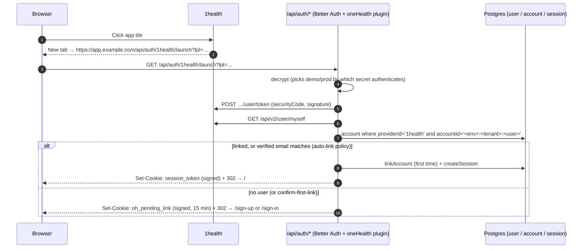

# Single Sign-On from the 1health App Launcher into a Better Auth App (Postgres/Neon, Drizzle)

**Technical white paper for developers.** Version 0.2 (draft), October 2026. Tachin.
Verified against **better-auth 1.6.29** (`@better-auth/core` 1.6.29, `better-call` 1.4.0) and Next.js 16 (App Router).

> **Verification status (v0.2).** The code in §5–§6 is identical to the skill templates and has been checked in three ways:
> 1. **Type-checks** against better-auth 1.6.29 at both ES2022 and ES6 targets.
> 2. **Passes a 31-test vitest suite** (`skill/…/templates/tests/`). The suite runs the real plugin through `auth.handler` with the memory adapter and mocked 1health. It includes the failure cases that v0.1 got wrong, and fails three of them when run against the v0.1 plugin.
> 3. **Ran live against 1health demo** in a production Better Auth app, Carrier (Next.js 16.3, `pg` Pool, Neon on Vercel), in October 2026:
>    - a real tile click auto-linked and signed in an existing user;
>    - an unknown user got the prefilled registration;
>    - reloading a used launch gave `token_exchange_failed`;
>    - demo QA users gave `identity_no_email`.
>
> Completing a registration, the sign-up gate's error and an identity conflict have only been tested in the suite, not live. See the companion case study `02a-carrier-case-study.md`.
>
> **Changes from v0.1:**
> - unexpected errors redirect to `launch_failed` instead of a 500;
> - redirect detection uses `isAPIError` (an `instanceof APIError` check misses better-call's redirects);
> - `signUpPath` may carry a query string;
> - non-JWT tokens, non-JSON `/myself` and network timeouts map to stable codes;
> - `/myself` emails must be real addresses (demo QA users return usernames).

---

## 1. Summary

1health users can launch third-party apps from the 1health **Apps** screen. This paper shows how to make that launch sign the user straight into an app that authenticates with **Better Auth**. The typical setup is email and password sign-in, sessions stored in Postgres (often **Neon**), and **Drizzle** used for app queries.

What the user sees:

- **Known user.** If the user's verified 1health email matches an account in your app, clicking the app in 1health opens it in a new tab with the user **already signed in**.
- **Unknown user.** The app opens on **registration** with the email (and name) prefilled. When the user submits, the 1health identity is **linked** and they're signed in. They don't have to launch again.
- **Everyone else.** Normal sign-in doesn't change.

The core is a small **Better Auth server plugin** with one `GET` endpoint. The endpoint:

1. decrypts 1health's launch payload;
2. redeems its one-time code;
3. fetches the 1health identity;
4. finds the user;
5. creates a native Better Auth session with `internalAdapter.createSession()` + `setSessionCookie()`. These are the same primitives Better Auth's own sign-in routes use.

The 1health link is stored as a row in Better Auth's existing **`account` table** (`providerId = "1health"`), so the integration **needs no schema changes**.

> **Why not `genericOAuth` or `sso`?** 1health's launch is a proprietary handshake that 1health starts, not an OAuth/OIDC authorization-code redirect. Better Auth's OAuth plugins expect to start the flow themselves and receive a `code` at a callback URL. 1health never sends one. A custom endpoint is the correct fit.

---

## 2. The 1health launch protocol (summary)

The protocol is identical for every app stack. The full specification and the documentation discrepancies are in the companion paper (*… into a Supabase-Authenticated App*, §2 and §9). In brief:

| Step | Detail |
|---|---|
| Launch | 1health opens `https://<launch-url>?lpl=<payload>` in a new tab. |
| Payload | `Base64(IV[12] ‖ AES-256-GCM ciphertext ‖ tag[16])`. The key is `HKDF-SHA256(launch secret, salt=∅, info=∅, 32 bytes)`. |
| Contents | `required.{apiKey.name, tenant.id, user.id, oneTimeCode.{value,issuedAt,expiresAt}}` plus `optional.{user_first_name, user_last_name, provider_npi, journey_id, encounter_id, …}` |
| One-time code | 16 alphanumeric characters, **single-use**, short-lived (API reference: "typically 5–10 minutes"). |
| Redeem | `POST {BASE}/api/v2/public/external-application/auth/oauth2/user/token` with body `{securityCode, signature: Base64(HMAC-SHA256(launch secret, code))}`. Returns `access_token`, `refresh_token`, `expires_in`. |
| Identity | Identifying claims in the access token are **encrypted**. Call `GET {BASE}/api/v2/user/myself` (Bearer) and read `email` and `emailVerified`. Only `externalApplicationId`, `tenantId`, `iat` and `exp` are plain text in the token. |
| Base URLs | Demo `https://demo.1health.io`, production `https://app.1health.io`. Each environment has its own app registration, launch secret and app ID. |

---

## 3. Architecture in a Better Auth app



Where things live in a typical Next.js project:

| File | Change |
|---|---|
| `lib/one-health/protocol.ts` | **New.** Decrypt, redeem, and fetch identity. Plain TypeScript with no framework dependencies. |
| `lib/one-health/plugin.ts` | **New.** The Better Auth plugin: endpoints and an after-sign-in hook. |
| `lib/auth.ts` | Add `plugins: [oneHealth({...})]` to `betterAuth({...})`. |
| `app/api/auth/[...all]/route.ts` | No change. The catch-all `toNextJsHandler(auth)` already serves the plugin's routes. |
| Sign-up page/form | When `?source=1health`, prefill a read-only email and post to the plugin's `complete-registration` endpoint. |
| Sign-in page | When `?source=1health` or `?error=…`, show a short message. |
| `.env` / hosting secrets | 1health secrets and app IDs (§4.3). |
| Optional migration | An audit table (§6.6). |

---

## 4. Configuration

### 4.1 1health

1. Sign in to 1health as a tenant **manager** (start in demo) and go to **Settings → Apps**. Add an **External Application** with a name and icon.
2. Set the **launch URL** to `https://<your-production-origin>/api/auth/1health/launch`. Use `{BETTER_AUTH_URL}{basePath}/1health/launch` if you changed `basePath`. It must be **HTTPS** and a stable origin. Don't use a preview-deployment URL.
3. Copy the **launch secret** (the API key assigned to the app, or `launchSecret` from the create API) straight into your secrets manager. It is shown **once**.
4. Note the **External Application ID**. Set the app to **Active**, and set its visibility (`isPublic`, or the allowed organizations for a private app).
5. Testers need a role that can see the Apps screen. In practice that is *manager*; it was not visible to *employee*.
6. Repeat on production (`app.1health.io`) when you go live.

### 4.2 Better Auth

- **`baseURL`.** Set `BETTER_AUTH_URL` explicitly to the production origin. If `baseURL` is derived from per-deployment URLs (for example `VERCEL_URL`), preview deployments get different origins. The launch URL registered in 1health only ever points at production anyway.
- **`trustedOrigins`.** No change for the launch itself, which is a top-level `GET`. The registration `POST` is same-origin.
- **Account linking settings.** `account.accountLinking` controls OAuth providers that link automatically. This plugin links explicitly through `internalAdapter.linkAccount`, so it isn't affected. Your linking policy (`linkPolicy`, §6.1) lives in the plugin's options.
- **Sign-up gates you already have.** A `databaseHooks.user.create.before` hook (for example allowed email domains or invite lists) **also runs for 1health registrations**, because the plugin creates users through `internalAdapter.createUser`, which calls your hooks. Usually that's what you want. Make sure the registration UI shows the hook's error message.
- **`emailAndPassword.requireEmailVerification`.** Sessions created by the plugin don't pass through the email/password sign-in check. The plugin sets `emailVerified = true` when it links, because `resolveLaunch` only accepts emails 1health has verified (§5).
- **Plugin order.** Put `oneHealth()` before `nextCookies()` if you use `nextCookies()` (it should be the last plugin). Apps that sign in from the client with `authClient` often don't use it and don't need it for this integration.

### 4.3 Environment variables

| Variable | Notes |
|---|---|
| `ONE_HEALTH_DEMO_LAUNCH_SECRET`, `ONE_HEALTH_DEMO_APP_ID` | Demo registration. |
| `ONE_HEALTH_PROD_LAUNCH_SECRET`, `ONE_HEALTH_PROD_APP_ID` | Production registration. Set only the environments you use. |
| `ONE_HEALTH_ALLOWED_TENANT_IDS` | Optional, for example `demo:123,prod:456`. |
| `ONE_HEALTH_LINK_POLICY` | `auto-link` (default) or `confirm-first-link`. |
| `BETTER_AUTH_URL`, `BETTER_AUTH_SECRET` | Existing. The plugin signs its pending-link cookie with Better Auth's own secret, so no new secret is needed. |
| `DATABASE_URL` | Existing. Use the pooled Neon URL at runtime and the unpooled URL (`DATABASE_URL_UNPOOLED`) for migrations. |

Never put 1health secrets in `NEXT_PUBLIC_*` variables or client code.

### 4.4 Database: no schema changes

Better Auth's `account` table already models "this user has an identity at provider X with ID Y":

| Column | Value for a 1health link |
|---|---|
| `providerId` | `"1health"` |
| `accountId` | `"<env>:<tenantId>:<userId>"`, e.g. `"demo:123:456"` |
| `userId` | Your user's ID |
| `accessToken`, `refreshToken`, `password` | **NULL**. Don't store 1health tokens unless you call 1health APIs on the user's behalf. If you do, encrypt them. |

Better Auth looks these rows up with `internalAdapter.findAccountByProviderId(accountId, providerId)`. A unique index on `(providerId, accountId)` is good practice. Add it if your schema doesn't already enforce uniqueness:

```sql
create unique index if not exists account_provider_account_uidx on "account" ("providerId", "accountId");
```

If your Drizzle schema mirrors the Better Auth tables (camelCase columns such as `providerId`), no Drizzle changes are needed. To query links from app code:

```ts
import { and, eq } from "drizzle-orm";
import { account } from "@/lib/db/schema";

const links = await db.select().from(account)
  .where(and(eq(account.userId, userId), eq(account.providerId, "1health")));
```

### 4.5 Runtime and hosting

- **Node.js runtime.** The protocol uses `node:crypto` (HKDF, AES-GCM, HMAC). Don't set `export const runtime = "edge"` on the auth route.
- **Neon.** Better Auth works the same whether you pass a `pg` `Pool` (`database: pool`, using the built-in Kysely path) or `drizzleAdapter(db, { provider: "pg" })`. The plugin only uses `ctx.context.internalAdapter`, so it works with either. Serverless drivers (`@neondatabase/serverless`) also work. Keep connections pooled.
- **Next.js 16 `proxy.ts` (formerly `middleware.ts`).** If you have one, make sure its matcher doesn't intercept `/api/auth/1health/*` (for example by redirecting signed-out users to `/sign-in`).
- **Logs.** The `lpl` query string must not end up in request logs. `next dev` prints full request URLs, and Vercel request logs include query strings, so filter what you ship to log drains. The payload is single-use, but it still identifies a user and tenant.
- **Preview deployments.** Vercel env vars are scoped per environment: a var added for Production isn't visible to Preview until you add that scope and redeploy. Preview deployments often share the production database.

---

## 5. The protocol module (`lib/one-health/protocol.ts`)

This module is framework-independent and works the same in any Node server.

```ts
// 1health launch handshake: encrypted `lpl` payload → one-time-code redemption → /api/v2/user/myself.
// Framework-independent; every failure is a LaunchError with a stable code (see references/troubleshooting.md).
import { createDecipheriv, createHmac, hkdfSync } from "node:crypto";
import { decodeJwt } from "jose";

export const ENVIRONMENTS = {
  demo: { base: "https://demo.1health.io", secret: process.env.ONE_HEALTH_DEMO_LAUNCH_SECRET, appId: process.env.ONE_HEALTH_DEMO_APP_ID },
  prod: { base: "https://app.1health.io",  secret: process.env.ONE_HEALTH_PROD_LAUNCH_SECRET, appId: process.env.ONE_HEALTH_PROD_APP_ID },
} as const;
export type OneHealthEnv = keyof typeof ENVIRONMENTS;

export class LaunchError extends Error {
  constructor(public code: string) { super(code); }
}

export interface OneHealthIdentity {
  env: OneHealthEnv; tenantId: string; userId: string; email: string;
  firstName?: string; lastName?: string;
}

const TIMEOUT_MS = 10_000;  // a hung 1health call must not hold the function open until the platform kills it
// /myself can return a username in `email` with emailVerified: true (observed for demo QA/system users).
const EMAIL_RE = /^[^@\s]+@[^@\s]+\.[^@\s]+$/;

const deriveKey = (secret: string) =>
  Buffer.from(hkdfSync("sha256", Buffer.from(secret, "utf8"), Buffer.alloc(0), Buffer.alloc(0), 32));

/** Decrypt the payload; the environment is whichever configured secret authenticates it. */
export function decryptLaunchPayload(lpl: string) {
  const raw = Buffer.from(lpl, "base64");
  if (raw.length < 28) throw new LaunchError("payload_invalid");
  const iv = raw.subarray(0, 12), tag = raw.subarray(raw.length - 16), ct = raw.subarray(12, raw.length - 16);
  for (const env of Object.keys(ENVIRONMENTS) as OneHealthEnv[]) {
    const secret = ENVIRONMENTS[env].secret;
    if (!secret) continue;
    let data: any;
    try {
      const d = createDecipheriv("aes-256-gcm", deriveKey(secret), iv);
      d.setAuthTag(tag);
      data = JSON.parse(Buffer.concat([d.update(ct), d.final()]).toString("utf8"));
    } catch { continue; }
    const r = data?.required, code = r?.oneTimeCode?.value;
    if (typeof code !== "string" || !/^[A-Za-z0-9]{16}$/.test(code) || r?.tenant?.id == null || r?.user?.id == null)
      throw new LaunchError("payload_invalid");
    return { env, tenantId: String(r.tenant.id), userId: String(r.user.id), code,
             optional: (data.optional ?? {}) as Record<string, string | undefined> };
  }
  throw new LaunchError("payload_invalid");
}

/** fetch with a timeout; network errors and timeouts become `code`. */
async function call(url: string, init: RequestInit, code: string) {
  try {
    return await fetch(url, { ...init, cache: "no-store", signal: AbortSignal.timeout(TIMEOUT_MS) });
  } catch {
    throw new LaunchError(code);
  }
}

export async function redeemOneTimeCode(env: OneHealthEnv, code: string) {
  const { base, secret } = ENVIRONMENTS[env];
  // HMAC uses the RAW launch secret, not the HKDF-derived key.
  const signature = createHmac("sha256", secret!).update(code, "utf8").digest("base64");
  const res = await call(`${base}/api/v2/public/external-application/auth/oauth2/user/token`, {
    method: "POST", headers: { "Content-Type": "application/json" },
    body: JSON.stringify({ securityCode: code, signature }),
  }, "token_exchange_failed");
  const body = await res.json().catch(() => null);
  if (!res.ok || typeof body?.access_token !== "string") throw new LaunchError("token_exchange_failed");
  return body as { access_token: string; refresh_token?: string; expires_in: number };
}

function tenantAllowed(env: OneHealthEnv, tenantId: string) {
  const list = process.env.ONE_HEALTH_ALLOWED_TENANT_IDS?.split(",").map((s) => s.trim()).filter(Boolean);
  return !list?.length || list.includes(`${env}:${tenantId}`);
}

/** Full launch → verified identity. 1health tokens are discarded when this returns. */
export async function resolveLaunch(lpl: string): Promise<OneHealthIdentity> {
  const launch = decryptLaunchPayload(lpl);
  const { access_token } = await redeemOneTimeCode(launch.env, launch.code);
  const { base, appId } = ENVIRONMENTS[launch.env];

  // Read the plain-text claim without checking the signature: /myself below proves the token is genuine.
  let claims: Record<string, unknown>;
  try { claims = decodeJwt(access_token); } catch { throw new LaunchError("token_exchange_failed"); }
  if (String(claims.externalApplicationId) !== String(appId)) throw new LaunchError("wrong_application");

  const res = await call(`${base}/api/v2/user/myself`, {
    headers: { Authorization: `Bearer ${access_token}` },
  }, "identity_lookup_failed");
  if (!res.ok) throw new LaunchError("identity_lookup_failed");
  const me = await res.json().catch(() => null);
  if (!me || typeof me !== "object") throw new LaunchError("identity_lookup_failed");
  const email = String(me.email ?? "").trim().toLowerCase();
  if (!EMAIL_RE.test(email)) throw new LaunchError("identity_no_email");
  if (me.emailVerified !== true) throw new LaunchError("email_not_verified");
  if (!tenantAllowed(launch.env, launch.tenantId)) throw new LaunchError("tenant_not_allowed");

  return {
    env: launch.env, tenantId: launch.tenantId, userId: launch.userId, email,
    firstName: launch.optional.user_first_name ?? me.firstName ?? undefined,
    lastName:  launch.optional.user_last_name  ?? me.lastName  ?? undefined,
  };
}
```

`jose` is the only new dependency for this module. Any JWT library that can decode without verifying will do. The plugin in §6 also needs `zod` as a **direct** dependency; it's often only a transitive dependency of better-auth.

**Why each check exists.** `externalApplicationId` rejects tokens issued for another app. `emailVerified` means 1health vouches for the address. The address-format check exists because demo QA/system users return a *username* in `email`, still with `emailVerified: true`. The 10-second timeout keeps a hung 1health call from holding a serverless function open. Every failure becomes a `LaunchError` code, never an unhandled exception.

> **Byte-compatibility.** `hkdfSync` with an empty salt is equivalent to the 32-zero-byte salt used in 1health's own template (RFC 5869). Add a unit test that decrypts a payload captured from demo before you rely on any port.

---

## 6. The Better Auth plugin (`lib/one-health/plugin.ts`)

### 6.1 Code

```ts
import type { BetterAuthPlugin } from "better-auth";
import { APIError, createAuthEndpoint, createAuthMiddleware, isAPIError } from "better-auth/api";
import { setSessionCookie } from "better-auth/cookies";
import * as z from "zod";
import { LaunchError, resolveLaunch, type OneHealthIdentity } from "./protocol";

const PROVIDER_ID = "1health";
const PENDING = "oh_pending_link";
const PENDING_TTL_S = 15 * 60;

type LinkPolicy = "auto-link" | "confirm-first-link";
export interface OneHealthOptions {
  linkPolicy?: LinkPolicy;            // default: env ONE_HEALTH_LINK_POLICY or "auto-link"
  signInPath?: string;                // default "/sign-in"
  signUpPath?: string;                // default "/sign-up"; may carry a query string (e.g. "/sign-up?invite=open")
  afterLaunchPath?: string;           // default "/"
  onLaunch?: (e: { outcome: "success" | "no_user" | "pending_confirm" | "failure"; reason?: string;
                   env?: string; tenantId?: string; oneHealthUserId?: string; userId?: string }) => Promise<void> | void;
}

export type OneHealthLaunchEvent = Parameters<NonNullable<OneHealthOptions["onLaunch"]>>[0];

const accountIdOf = (i: Pick<OneHealthIdentity, "env" | "tenantId" | "userId">) => `${i.env}:${i.tenantId}:${i.userId}`;

/** Append a query param to a path that may already have a query string. */
const withParam = (path: string, key: string, value: string) =>
  `${path}${path.includes("?") ? "&" : "?"}${key}=${encodeURIComponent(value)}`;

/** ctx.redirect() throws better-call's APIError("FOUND"), which is NOT `instanceof` the APIError exported by
 *  better-auth/api (different class). isAPIError() recognises both. */
const isRedirect = (e: unknown) => isAPIError(e) && e.status === "FOUND";

export const oneHealth = (opts: OneHealthOptions = {}) => {
  const policy: LinkPolicy = opts.linkPolicy ?? (process.env.ONE_HEALTH_LINK_POLICY as LinkPolicy) ?? "auto-link";
  const signIn = opts.signInPath ?? "/sign-in";
  const signUp = opts.signUpPath ?? "/sign-up";
  const home = opts.afterLaunchPath ?? "/";
  const audit = async (e: Parameters<NonNullable<OneHealthOptions["onLaunch"]>>[0]) => {
    try { await opts.onLaunch?.(e); }
    catch (err) { console.warn("[1health] audit hook failed", { error: (err as Error)?.message }); } // never break sign-in
  };

  async function setPending(ctx: any, identity: OneHealthIdentity) {
    const value = JSON.stringify({ ...identity, exp: Date.now() + PENDING_TTL_S * 1000 });
    await ctx.setSignedCookie(PENDING, value, ctx.context.secret, {
      httpOnly: true, secure: true, sameSite: "lax", path: "/", maxAge: PENDING_TTL_S,
    });
  }
  async function readPending(ctx: any): Promise<OneHealthIdentity | null> {
    const raw = await ctx.getSignedCookie(PENDING, ctx.context.secret);
    if (!raw) return null;
    try {
      const v = JSON.parse(raw);
      return v.exp > Date.now() ? (v as OneHealthIdentity) : null;
    } catch { return null; }
  }
  const clearPending = (ctx: any) => ctx.setCookie(PENDING, "", { path: "/", maxAge: 0 });

  async function link(ctx: any, userId: string, identity: OneHealthIdentity) {
    await ctx.context.internalAdapter.linkAccount({ userId, providerId: PROVIDER_ID, accountId: accountIdOf(identity) });
  }

  return {
    id: "one-health",
    endpoints: {
      /** 1health launch URL: GET {baseURL}/api/auth/1health/launch?lpl=… */
      oneHealthLaunch: createAuthEndpoint("/1health/launch", {
        method: "GET",
        query: z.object({ lpl: z.string().optional() }),
      }, async (ctx) => {
        let identity: OneHealthIdentity | undefined;
        try {
          if (!ctx.query.lpl) throw new LaunchError("launch_missing");
          identity = await resolveLaunch(ctx.query.lpl);
          const ia = ctx.context.internalAdapter;

          // 1. Already linked?
          const linked = await ia.findAccountByProviderId(accountIdOf(identity), PROVIDER_ID);
          let user = linked ? await ia.findUserById(linked.userId) : null;

          // 2. Otherwise, match on the verified email.
          if (!user) {
            const found = await ia.findUserByEmail(identity.email, { includeAccounts: true });
            if (found) {
              if (found.accounts.some((a) => a.providerId === PROVIDER_ID))
                throw new LaunchError("identity_conflict");            // email already linked to another 1health user
              if (policy === "confirm-first-link") {
                await setPending(ctx, identity);
                await audit({ outcome: "pending_confirm", env: identity.env, tenantId: identity.tenantId, oneHealthUserId: identity.userId });
                throw ctx.redirect(withParam(signIn, "source", "1health"));
              }
              await link(ctx, found.user.id, identity);
              if (!found.user.emailVerified) await ia.updateUser(found.user.id, { emailVerified: true });
              user = found.user;
            }
          }

          // 3. No account: registration with the email prefilled.
          if (!user) {
            await setPending(ctx, identity);
            await audit({ outcome: "no_user", env: identity.env, tenantId: identity.tenantId, oneHealthUserId: identity.userId });
            throw ctx.redirect(withParam(signUp, "source", "1health"));
          }

          // 4. Native Better Auth session.
          const session = await ia.createSession(user.id);
          await setSessionCookie(ctx, { session, user });
          await audit({ outcome: "success", env: identity.env, tenantId: identity.tenantId, oneHealthUserId: identity.userId, userId: user.id });
          throw ctx.redirect(home);
        } catch (e) {
          if (isRedirect(e)) throw e;                                  // the redirects thrown above
          const code = e instanceof LaunchError ? e.code : "launch_failed";
          // Unexpected (DB, adapter, hook) errors get a friendly page too. Never log lpl, tokens or /myself bodies.
          if (!(e instanceof LaunchError)) console.error("[1health] launch failed", { error: (e as Error)?.message });
          await audit({ outcome: "failure", reason: code, env: identity?.env, tenantId: identity?.tenantId, oneHealthUserId: identity?.userId });
          throw ctx.redirect(withParam(signIn, "error", code));
        }
      }),

      /** Registration page reads the prefill. Never returns tenant/user ids. */
      oneHealthPending: createAuthEndpoint("/1health/pending", { method: "GET" }, async (ctx) => {
        const p = await readPending(ctx);
        if (!p) throw new APIError("NOT_FOUND", { message: "No pending 1health link" });
        return ctx.json({ email: p.email, firstName: p.firstName ?? null, lastName: p.lastName ?? null });
      }),

      /** Create the account for a pending 1health identity, link it, and sign in. */
      oneHealthCompleteRegistration: createAuthEndpoint("/1health/complete-registration", {
        method: "POST",
        body: z.object({ name: z.string().trim().min(1), password: z.string() }),
      }, async (ctx) => {
        const p = await readPending(ctx);
        if (!p) throw new APIError("BAD_REQUEST", { message: "Your 1health launch expired. Launch the app from 1health again." });
        const { password } = ctx.body;
        const { minPasswordLength, maxPasswordLength } = ctx.context.password.config;
        if (password.length < minPasswordLength || password.length > maxPasswordLength)
          throw new APIError("BAD_REQUEST", { message: `Password must be ${minPasswordLength}-${maxPasswordLength} characters.` });

        const ia = ctx.context.internalAdapter;
        if (await ia.findUserByEmail(p.email))
          throw new APIError("BAD_REQUEST", { message: "An account with this email already exists. Sign in instead." });

        // Runs your databaseHooks.user.create (e.g. domain gate, workspace membership). A gate's APIError
        // propagates to the client unchanged, so the registration form can show its message.
        const user = await ia.createUser({ email: p.email, name: ctx.body.name, emailVerified: true });
        await ia.linkAccount({ userId: user.id, providerId: "credential", accountId: user.id,
                               password: await ctx.context.password.hash(password) });
        await link(ctx, user.id, p);

        const session = await ia.createSession(user.id);
        await setSessionCookie(ctx, { session, user });
        clearPending(ctx);
        await audit({ outcome: "success", env: p.env, tenantId: p.tenantId, oneHealthUserId: p.userId, userId: user.id });
        return ctx.json({ redirectTo: home });
      }),
    },

    hooks: {
      after: [{
        // confirm-first-link, and users who register through the normal form during a pending launch:
        // after any successful sign-in or sign-up, link the pending 1health identity if the emails match.
        matcher: (ctx) => !!ctx.path && (ctx.path.startsWith("/sign-in") || ctx.path.startsWith("/sign-up") || ctx.path.startsWith("/verify-email")),
        handler: createAuthMiddleware(async (ctx) => {
          const s = ctx.context.newSession;
          if (!s) return;
          const p = await readPending(ctx);
          if (!p || p.email !== s.user.email.toLowerCase()) return;
          const existing = await ctx.context.internalAdapter.findAccountByProviderId(accountIdOf(p), PROVIDER_ID);
          if (!existing) await link(ctx, s.user.id, p);
          clearPending(ctx);
        }),
      }],
    },
  } satisfies BetterAuthPlugin;
};
```

### 6.2 Wire it in (`lib/auth.ts`)

```ts
import { betterAuth } from "better-auth";
import { oneHealth } from "./one-health/plugin";

export const auth = betterAuth({
  // …existing config (database, baseURL, emailAndPassword, databaseHooks, session…)
  plugins: [
    oneHealth({
      signInPath: "/sign-in",
      signUpPath: "/sign-up",
      onLaunch: async (e) => { /* optional: insert into one_health_launch_audit (§6.6) */ },
    }),
    // nextCookies() last, if used
  ],
});
```

The existing catch-all `app/api/auth/[...all]/route.ts` (`toNextJsHandler(auth)`) now serves:

- `GET  /api/auth/1health/launch`: the URL you register in 1health
- `GET  /api/auth/1health/pending`
- `POST /api/auth/1health/complete-registration`

### 6.3 How each step maps to Better Auth internals

| Need | Better Auth 1.6 API used | Notes |
|---|---|---|
| Find a linked identity | `internalAdapter.findAccountByProviderId(accountId, providerId)` | Stable even if the user's email changes. |
| Find a user by email | `internalAdapter.findUserByEmail(email, { includeAccounts: true })` | Better Auth lower-cases emails when it stores them. |
| Link the identity | `internalAdapter.linkAccount({ userId, providerId: "1health", accountId })` | Writes a row to `account`. Unaffected by `account.accountLinking`. |
| Create a user | `internalAdapter.createUser({...})` | Runs `databaseHooks.user.create.before/after`. |
| Password credential | `ctx.context.password.hash()` + `linkAccount({ providerId: "credential", accountId: user.id, password })` | Mirrors `signUpEmail`. |
| Create a session | `internalAdapter.createSession(userId)` | Signature in 1.6: `(userId, dontRememberMe?, override?)`. Older 1.x versions took `ctx` as the second argument, so check your version. |
| Set the cookie | `setSessionCookie(ctx, { session, user })` from `better-auth/cookies` | Same call the OAuth callback uses before `throw ctx.redirect(...)`. Cookies survive the thrown redirect. |
| Pending-link cookie | `ctx.setSignedCookie` / `ctx.getSignedCookie` with `ctx.context.secret` | Signed with `BETTER_AUTH_SECRET`. No new secret. |
| After sign-in | `hooks.after` + `ctx.context.newSession` | Same pattern as the official `anonymous` and `jwt` plugins. |

`internalAdapter` is part of the context that plugins receive and is what the official plugins use. It isn't a documented end-user API, so **pin your Better Auth minor version** and re-run the integration tests (§8) when you upgrade.

**Two details that broke v0.1:**

- **Redirects are exceptions.** `ctx.redirect()` *throws* better-call's `APIError("FOUND")`. That is a different class from the `APIError` exported by `better-auth/api`, so `e instanceof APIError` is **false** for it. The launch endpoint must let redirects through with `isAPIError(e) && e.status === "FOUND"`, and turn everything else into a friendly `?error=` redirect. v0.1 rethrew every non-`LaunchError`, so a database hiccup showed users a raw 500.
- **Query strings in `signUpPath`.** v0.1 built `` `${signUp}?source=1health` ``, which breaks `"/sign-up?signup=enabled"`. The `withParam` helper appends correctly.

### 6.4 Registration UI

On the sign-up page, when `?source=1health` is present:

```tsx
"use client";
// Render on the sign-up page when ?source=1health is present. Adapt markup to the repo's form components.
// Supabase templates: change the two URLs to /1health/pending and /1health/complete-registration.
import { useEffect, useState } from "react";

type Pending = { email: string; firstName: string | null; lastName: string | null };

export function OneHealthRegistration({ fallback }: { fallback?: React.ReactNode }) {
  const [pending, setPending] = useState<Pending | null | undefined>(undefined);
  const [error, setError] = useState<string | null>(null);
  const [busy, setBusy] = useState(false);

  useEffect(() => {
    fetch("/api/auth/1health/pending", { cache: "no-store", credentials: "same-origin" })
      .then((r) => (r.ok ? r.json() : null)).then(setPending).catch(() => setPending(null));
  }, []);

  async function onSubmit(e: React.FormEvent<HTMLFormElement>) {
    e.preventDefault();
    setBusy(true); setError(null);
    const form = new FormData(e.currentTarget);
    const res = await fetch("/api/auth/1health/complete-registration", {
      method: "POST", credentials: "same-origin", headers: { "Content-Type": "application/json" },
      body: JSON.stringify({ name: form.get("name"), password: form.get("password") }),
    });
    const data = await res.json().catch(() => ({}));
    setBusy(false);
    if (!res.ok) return setError(data.message ?? "Registration failed.");
    window.location.assign(data.redirectTo ?? "/"); // full load so the server sees the new session
  }

  if (pending === undefined) return null;          // loading
  if (pending === null) return <>{fallback}</>;    // no pending launch: normal sign-up form
  return (
    <form onSubmit={onSubmit}>
      <p>You're coming from 1health. Create your account to finish connecting.</p>
      <label>Email <input name="email" type="email" value={pending.email} readOnly aria-readonly /></label>
      <label>Name <input name="name" defaultValue={[pending.firstName, pending.lastName].filter(Boolean).join(" ")} required /></label>
      <label>Password <input name="password" type="password" autoComplete="new-password" required /></label>
      {error && <p role="alert">{error}</p>}
      <button type="submit" disabled={busy}>{busy ? "Creating account…" : "Create account"}</button>
    </form>
  );
}
```

If sign-up is hidden behind a flag or an invite parameter, set the plugin's `signUpPath` to a URL that shows the form, for example `signUpPath: "/sign-up?signup=enabled"`. The plugin appends `&source=1health`. Server-side gates (database hooks) still apply, and the hook's error message reaches the form unchanged.

On the sign-in page, map `?error=` codes to friendly text. The most common is `token_exchange_failed`: *"This launch link has expired or was already used. Open the app from 1health again."* For `?source=1health` (confirm-first-link), show *"Sign in once to connect your 1health account."*

### 6.5 Other Node frameworks (Hono, Express, Fastify, …)

The plugin and protocol module don't depend on any framework. Mount Better Auth as you normally do, for example `app.on(["GET","POST"], "/api/auth/*", (c) => auth.handler(c.req.raw))` in Hono or `toNodeHandler(auth)` from `better-auth/node` in Express. The launch URL becomes `{origin}/api/auth/1health/launch`. Only the registration UI changes to fit your frontend.

### 6.6 Optional audit table (Drizzle + SQL)

```ts
// lib/db/schema.ts
export const oneHealthLaunchAudit = pgTable("one_health_launch_audit", {
  id: serial("id").primaryKey(),
  createdAt: timestamp("created_at", { withTimezone: true }).notNull().defaultNow(),
  outcome: text("outcome").notNull(),               // success | no_user | pending_confirm | failure
  reason: text("reason"),
  env: text("env"),
  tenantId: text("one_health_tenant_id"),
  oneHealthUserId: text("one_health_user_id"),
  userId: text("user_id"),
});
```

```sql
create table if not exists one_health_launch_audit (
  id serial primary key,
  created_at timestamptz not null default now(),
  outcome text not null, reason text, env text,
  one_health_tenant_id text, one_health_user_id text, user_id text
);
create index if not exists one_health_launch_audit_created_idx on one_health_launch_audit (created_at desc);
```

Run it the way your project runs migrations: `drizzle-kit`, hand-written SQL scripts, or the Neon console. Use the unpooled connection string. **Never** record emails, tokens, one-time codes or `/myself` responses.

---

## 7. Security checklist

| # | Control | |
|---|---|---|
| 1 | Launch secrets only in server environment variables or a secrets manager. Never `NEXT_PUBLIC_*`, never committed. | Required |
| 2 | `externalApplicationId` checked against the app ID for that environment | Required (in `resolveLaunch`) |
| 3 | `emailVerified === true` | Required |
| 4 | Linked identity checked first; `identity_conflict` rejected | Required |
| 5 | Tenant allow-list | Recommended for private apps |
| 6 | `confirm-first-link` wherever an email match alone must not merge accounts | Recommended for regulated or professional apps |
| 7 | Native Better Auth session; no hand-made tokens | Required |
| 8 | 1health tokens discarded, or encrypted at rest if needed | Required |
| 9 | Pending-link cookie: signed, HttpOnly, Secure, `SameSite=Lax`, 15 minutes, holds identity only | Required |
| 10 | Registration uses the **cookie's** email, never one from the request body | Required |
| 11 | `lpl` kept out of logs | Recommended |
| 12 | Rate limit on `/api/auth/1health/*` (Better Auth `rateLimit.customRules`) | Recommended |
| 13 | Audit row for each launch, identifiers only | Recommended |

Example rate limit:

```ts
rateLimit: { enabled: true, customRules: { "/1health/launch": { window: 60, max: 10 }, "/1health/complete-registration": { window: 60, max: 5 } } }
```

**Residual risk: login CSRF.** 1health starts the launch, so there's no `state` value tying it to the browser. Someone could send a victim a fresh launch link minted from their own 1health account, and the victim would be signed in as that person. The single-use code limits this, and so does a visible "Signed in as … via 1health" notice. `confirm-first-link` closes the gap for first-time links. You can also refuse to replace an existing session for a different user without asking: check `getSessionFromCtx(ctx)` at the start of the launch endpoint.

---

## 8. Local development and testing

- **Mint launches yourself.** The portal launches only the registered URL. For `localhost` or preview builds, mint a payload with a **demo QA user's API key**: `GET https://demo.1health.io/api/v2/external-application/{APP_ID}/launch-payload` with `Authorization: Bearer <key>` returns `{ launchPayload }`. Open `http://localhost:3000/api/auth/1health/launch?lpl=<urlencoded>` right away. In a Playwright test, navigate to that URL in the test browser.
  - Keep QA keys in `.env.local` only.
  - Gate any QA helper on `NODE_ENV !== "production"` **and** `VERCEL_ENV !== "production"`.
  - Demo throttles bursts, so don't retry in a loop.
- **QA users can't test linking.** On demo, QA/system users report a username in `/myself.email`, so they only reach `identity_no_email`. For the linking and registration scenarios, launch as demo users with real, verified emails: one that matches an existing app user, and one that doesn't.
- **Testing before merge.** The launch URL registered in 1health points at production, which returns 404 until the integration is deployed there. Two ways to reach a preview deployment:
  - Mint a launch for the preview URL.
  - Click the tile, then on the 404 page replace the origin in the address bar with the preview's, keeping `/api/auth/1health/launch?lpl=…`. The one-time code hasn't been spent.
- **Configuration probe.** `scripts/probe-launch.mjs <launchUrl>` sends a payload encrypted with your local secret but a fake code. `token_exchange_failed` proves the deployment has the right secret and reaches 1health. `payload_invalid` means its secret is missing or different (typically an env var not scoped to that environment). It takes one request and is safe against production.
- **HTTPS.** Better Auth's `secure` cookies need HTTPS outside `localhost`. `localhost` itself is fine.
- **Unit tests.**
  - Protocol module: encrypt a fixture with a test secret, then check the decrypt round-trip and the HMAC; mock `fetch` for the token and `/myself` calls.
  - Plugin: drive it through `auth.handler` with `memoryAdapter` and mocked 1health, mirroring your real `betterAuth({...})` config (gates, verification, plugin options). The skill ships this suite. For a database-level test, use a disposable Postgres or a Neon branch per pull request.
  - If the repo has no test runner, add vitest. Set the env in `setupFiles`, because the protocol module reads it at import time. Top-level `await` in tests fails `tsc` when tsconfig targets ES6.
- **Scenario matrix.**

  | Scenario | Expected result |
  |---|---|
  | Linked user | Signed in |
  | Matched email, auto-link | Linked and signed in |
  | Matched email, confirm-first-link | Sign-in page, then linked |
  | Unmatched email | Prefilled registration, then signed in and linked |
  | Unmatched email blocked by a sign-up gate | Clear error |
  | Unverified 1health email | Rejected |
  | Reloaded tab | "Launch again" |
  | Wrong environment's secret | `payload_invalid` |
  | Email already linked to a different 1health user | `identity_conflict` |
  | QA/system user (username as email) | `identity_no_email` |
  | Unexpected server error (e.g. database down) | `launch_failed` page, not a 500 |

---

## 9. Troubleshooting

| Symptom | Likely cause | Fix |
|---|---|---|
| `payload_invalid` | Wrong or rotated secret, or not the key assigned to the app | Configure the assigned secret, then launch again |
| `token_exchange_failed` | Code used or expired; app not Active | Launch again; activate the app |
| `wrong_application` | App ID env var doesn't match the registration for that environment | Set `ONE_HEALTH_<ENV>_APP_ID` |
| `email_not_verified` | 1health account email is unverified | Verify it in 1health |
| Lands on `/sign-in` with no error | `proxy.ts`/middleware intercepted `/api/auth/1health/*` | Exclude it from the matcher |
| Signed in on launch, then immediately signed out | Cookie not set: `secure` cookie over HTTP, or a different domain than `BETTER_AUTH_URL` | Use HTTPS and the same origin |
| `FORBIDDEN` on registration | Your `databaseHooks.user.create.before` rejected the email | Expected for gated apps. Show the message, or allow-list the domain or tenant. |
| Apps tile missing in 1health | User role can't see Apps | Use a manager role |
| Tile opens a **404** on production | Integration not deployed there yet | Test on a preview (§8), then merge |
| `payload_invalid` on a preview only | Env vars not scoped to Preview, or not redeployed after setting them | Add the scope, redeploy, run the probe |
| `identity_no_email` | `/myself` has no email address. Common for demo QA users. | Use a real-email account |
| `launch_failed` | Unexpected server error, logged as `[1health] launch failed` | Check the server log |

---

## 10. Documentation vs. working implementation

All the protocol-level differences between 1health's documents and what has been observed to work (one-time-code lifetime, names for the secret, token storage, environment detection, HKDF salt, token lifetimes, refresh endpoint, QA minting) are listed in §9 of the companion Supabase paper and apply here unchanged. Two points are specific to Better Auth:

| Topic | 1health agent guide / template | This paper |
|---|---|---|
| Server route | `POST /api/token` (Next.js route handler, browser posts `lpl`) | `GET /api/auth/1health/launch` (Better Auth plugin). The payload never touches client JavaScript. |
| Session | 1health tokens kept in non-HttpOnly cookies; 1health is the app's backend | Native Better Auth session (HttpOnly, signed). 1health tokens are discarded. |
| `/myself.email` | An email address | Usually. Demo QA/system users return a username with `emailVerified: true`. |

---

## 11. Open questions for 1health

The open questions in the companion paper's §10 also apply here: JWKS, the authoritative code lifetime, `emailVerified` guarantees (including why QA/system users report a username as a verified email), launch `state`/`returnTo`, and production registration.

---

## Appendix: Better Auth source references (1.6.29)

- `@better-auth/core/dist/types/context.d.mts`: `internalAdapter` method signatures (`createSession`, `findUserByEmail`, `findAccountByProviderId`, `linkAccount`, `createUser`, `updateUser`).
- `better-auth/dist/api/routes/sign-up.mjs`: the user + credential account + session sequence that `complete-registration` mirrors.
- `better-auth/dist/api/routes/callback.mjs`: `setSessionCookie` followed by `throw c.redirect(...)`.
- `better-auth/dist/plugins/anonymous/index.mjs`: the `hooks.after` matcher pattern.
- `better-auth/dist/db/internal-adapter.mjs`: `createUser` goes through `createWithHooks`, so database hooks run.
